# 官服 HTML 回放 · 纯安卓适配

> 最新补丁：[hotfix67 APK](https://github.com/pphy96826-coder/clashroyal-replay/releases/tag/replay-sync-20261022-hotfix67) · [更新说明与验证范围](更新说明-hotfix67.md)。包含灵魂女皇修复与匹配重复工作优化，同签名覆盖安装即可；以下 hotfix65 图文流程与完整资料包仍可参考，APK 请使用 hotfix67。本次尚未完成安卓整局耗时和播放实测。

**[下载 hotfix65](https://github.com/pphy96826-coder/clashroyal-replay/releases/tag/replay-sync-20261021-hotfix65)** · [PDF 版教程](安卓适配图文教程.pdf) · [离线 HTML](安卓适配图文教程.html) · [本版更新说明](更新说明-hotfix65.md) · [非 Root 安卓与 iOS 方案](../docs/非Root安卓与iOS播放方案.md) · [← 返回仓库首页](../README.md)

2026-10-21 / Android 2026.10.21-hotfix65 / 本页是**纯安卓适配**（控制台、游戏、浏览器都在同一个安卓系统里）的完整配置图文教程，取代旧版安卓教程和旧版 Mac 适配。Windows 电脑请用另一套 [Windows + MuMu 一体版](../docs/mumu-android/安装教程.md)。源码在 [source/android-native/](../source/android-native/README.md)。

| 路线 | 适用 | 状态 |
|---|---|---|
| A. Mac + MuMu 模拟器 Pro | Apple Silicon Mac | 推荐；hotfix9–11 实测 11 场，本版未在 MuMu 重测 |
| B. 已 Root 的安卓手机 | ARM64，Android 10–12 | 未实测 |
| C. 非 Root 手机 + 虚拟大师 | 外层 8 GB 内存以上 | **实验性**：完整播放过 2 次，之后多次因虚拟机调试器不稳定失败 |

本项目把 RoyaleAPI「完整 Replay 详情页」的 HTML 转成指令，在**锁定版本的腾讯安卓客户端**里用游戏自己的战斗引擎重新跑一遍。它不是视频播放器，也不是 Supercell 官方产品。所有操作都在安卓系统里完成：控制台 APK、游戏、浏览器装在同一个安卓环境中，不需要电脑后台服务。

本教程的截图均为**实机截图**，来自「非 Root 外层系统 + 虚拟大师 Android 12 客体」测试环境；你的游戏昵称、公会名已打码。MuMu 和已 Root 手机里的控制台界面与截图相同，只是外层系统不同。

**选择你的路线：**

- **Mac（Apple Silicon）**：用 MuMu 模拟器 Pro 运行安卓 12 实例，装本控制台。第 3 节。原来的 macOS 桌面版（源码 Skill）**已停止维护**，改用这条路线。
- **已 Root 的 ARM64 安卓手机 / 平板**：直接安装。第 4 节。
- **没有 Root 的安卓手机**：在手机上用「虚拟大师」开一个带 Root 的安卓 12 虚拟机，在虚拟机里安装。第 5–7 节。
- **Windows**：使用另一套独立适配 [Windows + MuMu 一体版](../docs/mumu-android/安装教程.md)（MuMu Windows 版需要翻译层）。本教程不适用。
- **iPhone / iPad**：没有本机方案，只能远程观看一台运行本项目的电脑或手机，见[《非 Root 安卓与 iOS：可能的播放方法》](../docs/非Root安卓与iOS播放方案.md)。

## 1. 下载清单

本次发布页：[replay-sync-20261021-hotfix65](https://github.com/pphy96826-coder/clashroyal-replay/releases/tag/replay-sync-20261021-hotfix65)

本项目提供的文件：

- `Android-Replay-20261021-hotfix65.apk`：安卓回放控制台。已内置全部运行依赖：Python 运行时、HTML 解析器、本机编译器与调试器（LLDB）。不需要另装 Python、NDK 或电脑工具。
- `Android-Replay-Complete-20261021-hotfix65.zip`：完整资料包。含上面的 APK、浏览器桥接脚本、本教程（PDF / HTML / Markdown 与全部截图）、安卓源码快照、第三方下载清单、组件许可和校验和。
- `royale-replay-phone.user.js`：Edge 浏览器桥接脚本（资料包里也有）。
- `SHA256SUMS.txt`：下载后核对文件是否完整。

需要从**官方渠道**自行获取的第三方软件（版权原因，本项目不打包、不转发）：

- MuMu 模拟器 Pro（Mac）：[mumu.163.com/mac](https://mumu.163.com/mac/)
- 虚拟大师（手机虚拟机）：[virtualmaster.app](https://virtualmaster.app/)，或手机的官方应用商店。
- Microsoft Edge（安卓）：Google Play，或 [Microsoft 官网](https://www.microsoft.com/edge/mobile)。
- 篡改猴 Tampermonkey：在 Edge 的扩展页面安装，见第 9 节。
- 腾讯版《皇室战争》客户端：腾讯官方渠道。必须是本项目审计过的版本（见第 2 节）。

## 2. 开始前的共同要求

1. **游戏版本必须完全匹配。**包名 `com.tencent.tmgp.supercell.clashroyale`，审计版本 38.4.2。控制台会校验游戏库 `libg.so` 的 SHA-256，不匹配就拒绝运行，不会“试一试”：

```text
c6b2482a2f1fbd2e15c99df7fb18ba3d5596b77b3a81930d3638241a3c37fe55
```

2. **安卓环境**：ARM64，Android 10–12。实测为 Android 12。游戏、控制台、Edge 必须装在**同一个安卓系统**里。
3. **Root**：控制台要以调试器方式附加游戏进程，需要该安卓系统**已有**的 Root，并只授权给「安卓回放控制台」。本项目不提供提权或绕过手段。
4. **内存**：运行游戏的那个安卓系统建议 ≥ 4 GB 可用内存。手机虚拟机路线下，**外层手机建议 8 GB 内存以上**（见第 5.2 节）。
5. **登录**：游戏账号、RoyaleAPI 网站登录都由你本人完成。开始播放前让游戏停在**空闲大厅**，不要正在进行在线对局。
6. **网络**：不需要改代理或 VPN。游戏和网站本身需要能联网。

## 3. 路线 A：Mac + MuMu 模拟器 Pro（原 Mac 适配）

旧的 macOS 桌面控制台需要在 Mac 上装 Python、命令行工具和 NDK，并在电脑端编译。现在改为：**控制台直接装进 MuMu 的安卓系统里运行**，Mac 上什么都不用装，与手机用的是同一个 APK。

1. 从 [MuMu 官网](https://mumu.163.com/mac/) 下载安装「MuMu 模拟器 Pro」（Apple Silicon 原生运行 ARM64 安卓，无需翻译层）。
2. 打开 MuMu，在多开管理中新建或使用一个 **Android 12** 实例并启动。
3. 在该实例的「设置 → 其他 / 高级」中开启 **Root 权限**，按提示重启实例。具体菜单名称以你的 MuMu 版本为准。
4. 在实例里安装腾讯版游戏 38.4.2，登录账号，进入大厅确认能正常显示。
5. 安装控制台：把 `Android-Replay-20261021-hotfix65.apk` 拖进 MuMu 窗口，或在 Mac 终端用 MuMu 自带 adb 安装。之后的步骤与第 8 节相同。
6. 第一次打开控制台时，Root 管理器会询问是否授权「安卓回放控制台」，选择允许。

已验证范围：MuMu Pro（Mac）安卓 12 实例上，hotfix9–11 完成过 11 场、24 次完整播放，其中 10 场终局与网页完全一致；不一致的一场由骷髅帝王随机技能造成，见 hotfix11 说明。hotfix12–25 的改动主要针对手机虚拟机，**尚未在 MuMu 上重新完整播放验证**；升级后请先用一场短局确认。

## 4. 路线 B：已 Root 的安卓手机

1. 把 APK 拷到手机上安装。只对你使用的文件管理器临时允许“安装未知应用”。
2. 安装腾讯版游戏 38.4.2，登录并进入大厅。
3. 打开控制台，在 Magisk / KernelSU 等 Root 管理器的弹窗里**只允许这个应用**。
4. 之后按第 8 节操作。

实体 Root 手机未经本项目实测。不同内核和 ROM 的调试支持差别很大，失败时请导出诊断（第 11 节）。

## 5. 路线 C：没有 Root 的手机 + 虚拟大师

思路：外层手机保持不 Root，用「虚拟大师」在手机里开一个**自带 Root 的 Android 12 虚拟手机**。游戏、控制台、Edge 全部装在虚拟手机里。

**状态：实验性。**测试环境为外层**非 Root 的 Android 14**（用户版系统，无法获得 Root），里面运行虚拟大师 3.2.77 + Android 12 ROM（1039）。

- 成功：hotfix21 与 hotfix24 各完整播放 1 场（02CY92GGGCLG），终局六塔与网页完全一致；hotfix24 起“读取资源”从约 2 分钟缩短到约 6 秒。
- 失败：之后在同一虚拟机里多次失败，原因都在虚拟机这一层，而不是回放规则：调试器无法暂停游戏或无法执行原生函数调用，同时虚拟大师弹出“core process crashed in the VM”。较长、需要反复预演的对局更容易遇到。
- 建议：能用 Mac + MuMu 就优先用 MuMu。在虚拟大师里先用短局（几十条指令、无英雄技能）试播。

### 5.1 安装与激活虚拟大师

激活流程（按顺序，每一步都由你本人在手机上操作）：

1. **安装**：从 [虚拟大师官网](https://virtualmaster.app/) 或手机官方应用商店下载安装虚拟大师（我们测试的版本为 3.2.77，包名 `com.clone.android.dual.space`）。
2. **首次启动的解锁页**：部分网盘分发的版本在第一次打开时会显示一个“输入密码”的解锁页，提示密码从发布者的网盘页面获取、“不定期更新”。这类版本是第三方重新打包的，官方版本没有这一步。请向**你获取安装包的来源**索取当前密码并自行输入；本教程不公开该密码（它会变化，公开后很快失效，也不应传播非官方分发版）。能用官方版本时优先用官方版本。
3. **同意协议**：阅读并同意用户协议与隐私政策（由你本人确认，本项目不代为同意）。
4. **登录 / 会员**：按官方指引完成账号登录。若带 Root 的 ROM、64 位 ROM 或更大内存需要会员，请通过官方渠道开通。
5. **授予权限**：在系统弹窗中允许“显示在其他应用上层”（虚拟大师悬浮球需要）、“文件和媒体 / 存储”（导入 APK 需要）、通知。位置权限与本项目无关，可拒绝。
6. **完成标志**：首页出现“新建虚拟机 / ROM 列表”，屏幕边缘出现虚拟大师的悬浮球。

### 5.2 创建 Android 12 虚拟手机

1. 在虚拟大师中新建虚拟机，选择 **Android 12（64 位）ROM**。我们使用的是 Android 12 ROM 1039。
2. 内存选 **4 GB 或以上**，存储 ≥ 16 GB。游戏安装包约 1.5 GB，解压后更大。
3. 在虚拟大师首页的虚拟机卡片上点 **Enter VM** 启动；卡片下方三个按钮依次是关机、声音和虚拟机设置。第一次启动会显示「Phone is starting…」，等待进入桌面。

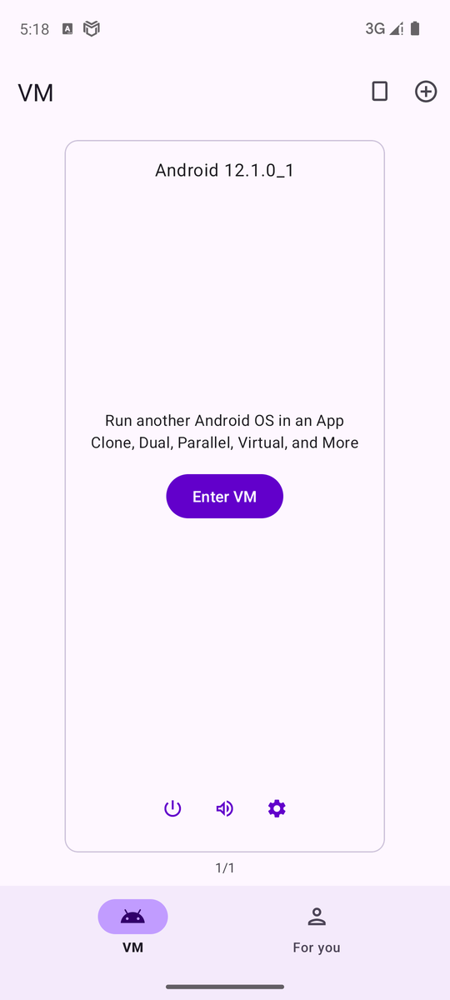


**内存不够是最常见的失败原因。**我们最初的测试手机只有 4 GB 内存，虚拟机里一跑游戏就反复弹出“core process crashed in the VM”，并自动重启虚拟机。把外层内存加到 8 GB 后恢复稳定。出现下图提示时，先关掉外层手机的其他应用，或换内存更大的手机，不要反复重装。

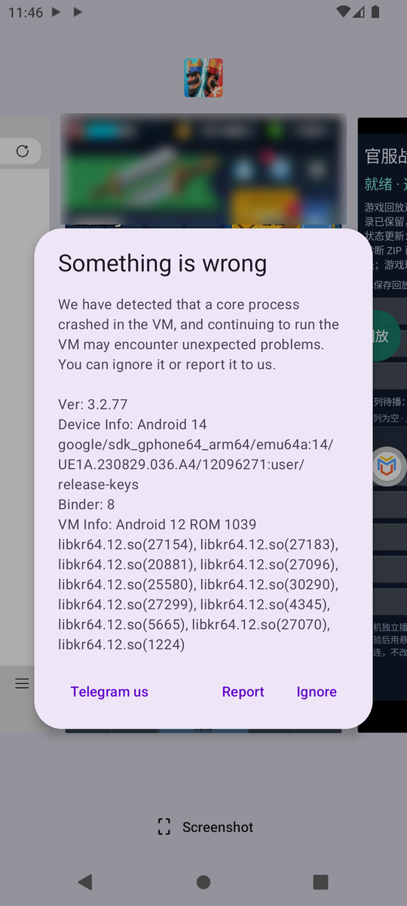

配置清单（我们实测可用的组合）：

| 项目 | 设置 |
|---|---|
| ROM | Android 12，64 位（ROM 1039） |
| 虚拟机内存 | 4 GB 及以上 |
| 虚拟机存储 | 16 GB 及以上，至少留 4 GB 空闲 |
| Root | 开启（虚拟机内有 Magisk + Superuser） |
| 外层手机内存 | 8 GB 及以上 |
| 网络 | 与外层手机相同，无需额外代理设置 |

### 5.3 打开虚拟手机的 Root

1. 在虚拟大师的虚拟机设置（或虚拟机内的「VM Settings」应用）中，打开 **Root** 开关，按提示重启虚拟机。
2. 重启后，虚拟机桌面会出现 **Magisk** 与 **Superuser** 两个应用，说明 Root 已就绪。下图为我们测试用的虚拟手机桌面：Edge、Magisk、Superuser、VM Settings、安卓回放控制台、部落冲突·皇室战争都在里面。

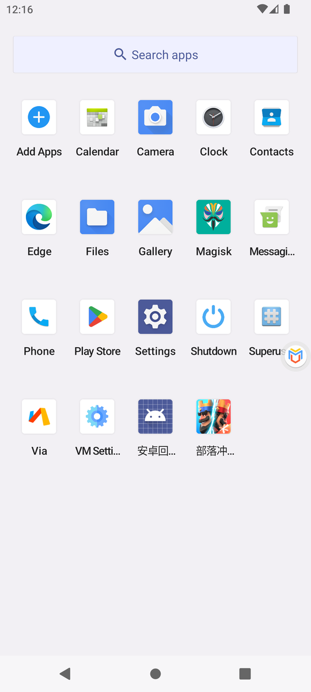

### 5.4 把安装包导入虚拟手机

虚拟手机和外层手机的存储是分开的，需要用虚拟大师的「导入」把 APK 送进去：

1. 先在外层手机下载好 APK（控制台、游戏、Edge）。
2. 点屏幕边缘虚拟大师的悬浮球，展开菜单，点 **Import（导入）**。菜单里还有 Home（回到虚拟桌面）、Back、Recents、Switch VM、Shutdown 等。
3. 点导入页右下角的文件夹按钮，从外层手机的下载目录选择 APK。导入后虚拟大师会自动在虚拟手机里安装。

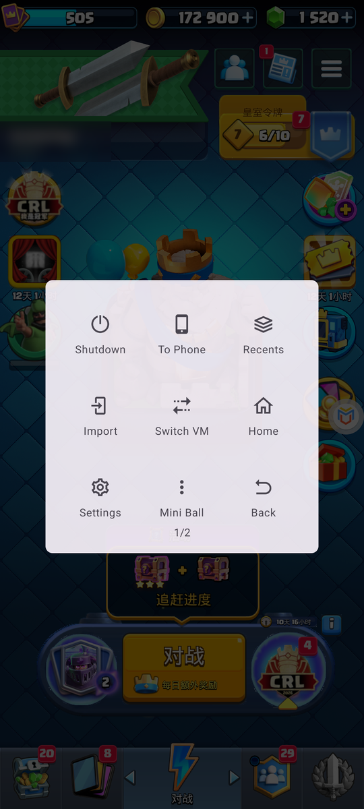
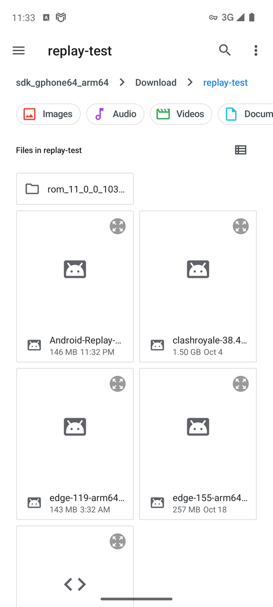

注意：

- 虚拟手机的空间和外层手机共用。出现“Install failed insufficient storage”时，先删掉外层手机下载目录里已经导入过的安装包（游戏安装包约 1.5 GB），再重新导入。
- 导入记录长时间停在“Copying file 100%”、新的导入一直不开始时：在外层手机的最近任务里关闭虚拟大师，重新打开、进入虚拟机后再导入一次。
- 装完后用「长按应用图标 → App info」拉到最下方核对版本号（例如 `version 2026.10.21-hotfix65`），不要只看导入记录。

## 6. 在虚拟手机里安装游戏

1. 导入并安装腾讯版游戏 38.4.2。
2. 在虚拟手机里打开游戏，登录账号，等待资源下载完成，**确认能稳定进入大厅**。游戏本身闪退或黑屏时，先解决游戏问题（内存、ROM），不要继续部署。
3. 游戏内弹出的活动页用返回键关闭，停在大厅。

## 7. 在虚拟手机里安装控制台与 Edge

1. 导入并安装 `Android-Replay-20261021-hotfix65.apk`（安卓回放控制台）。升级时直接覆盖安装，**不要卸载或清除数据**，否则队列和记录会丢失。
2. 导入并安装 Microsoft Edge（安卓 ARM64 版）。
3. 打开控制台。屏幕下方出现“安卓回放控制台 was granted Superuser rights”表示 Root 授权成功；若 Superuser 弹出询问，只允许这个应用。
4. 第一次播放前，系统会请求“显示在其他应用上层”（悬浮窗）权限，只给安卓回放控制台开启。

## 8. 第一次播放

控制台主界面（下图）从上到下是：状态、已保存回放、打开 RoyaleAPI 网页、选择 HTML 并播放、添加多个 HTML 到队列、待播队列、播放下一个、倍速、重放、导出诊断等。

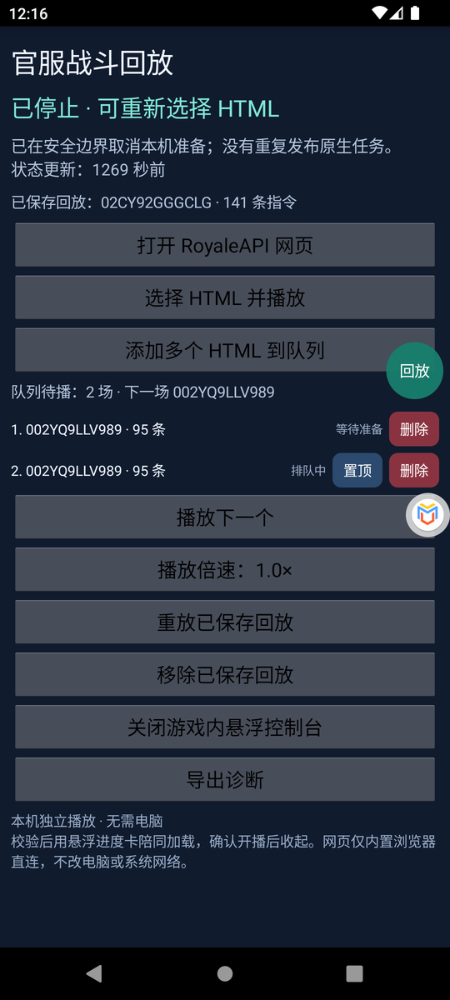

1. 先打开游戏并停在大厅。
2. 在控制台点「选择 HTML 并播放」，选择从 RoyaleAPI 完整 Replay 详情页保存的 HTML；也可以用第 9 节的浏览器一键发送。
3. 控制台依次显示：读取资源 → 校准初始手牌 → 整局预演 → 往返校验 → 等待游戏前台加载 → 播放中。
4. 预演会把终局六座塔的血量与网页逐塔对比（网页上左右公主塔的顺序不一定和场地一致，程序只在血量能证明时交换左右），并标注：完全一致 / 终局近似（被摧毁的塔相同）/ 仅胜负相同 / 不符 / 无法完整比对（某座塔缺少网页数据或模拟记录，不当作不一致）。
5. **英雄技能目标必须完全一致**：技能有多个合法目标时，只采用整局终局塔血与网页完全一致的那个分支，绝不用“最接近”的分支代替；找不到就不播放。
6. **随机种子只在卡组含骷髅之王或猎人时搜索**（这两张卡的技能或弹道有已知随机性）。其他对局一律保留原种子，终局不一致时如实标出，不会因为塔血不同就去换种子。搜索时最多尝试 60 个种子，可随时点「停止匹配，用当前最接近的开播」；放宽的只是随机种子，技能目标仍要求完全一致。
7. 预演通过后会自动切到游戏，加载对战画面，确认游戏实际在步进后悬浮卡自动收起。

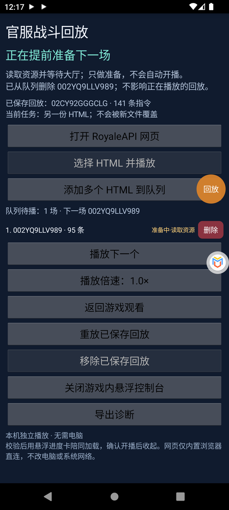
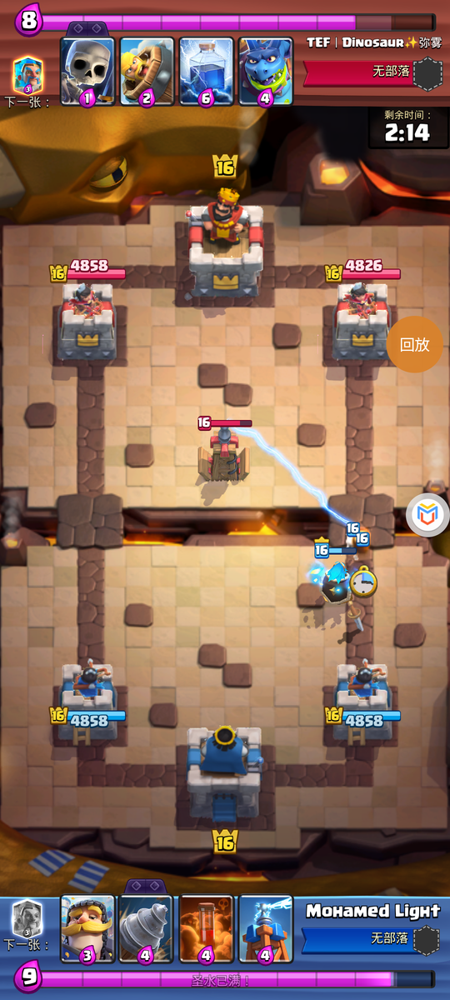

耗时参考（虚拟大师 Android 12）：读取资源约 6 秒（旧版约 2 分钟），校准与整局预演约 1–2 分钟，加载对战画面约 20–40 秒；需要尝试随机种子时，每个种子约 10 秒。在 MuMu 上更快。

播放中可使用游戏自带的暂停和倍速。对局结束后：

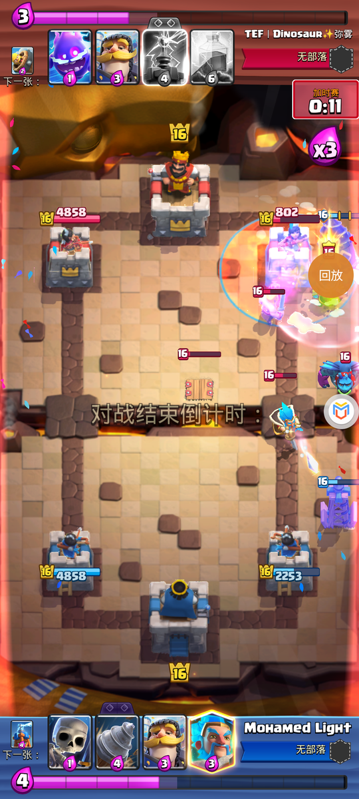


播完后，游戏会被安全地重启并回到大厅（当前采用“核验归属 → 释放 → 重新打开客户端”的方式，不是免重启返回）。之后可以在悬浮面板或控制台选择「重放本场」「退出回放」或播放队列的下一场。

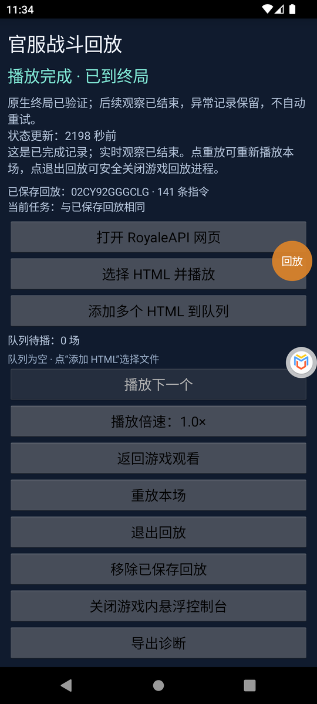

## 9. 游戏内悬浮控制台与 Edge 浏览器桥接

### 9.1 悬浮控制台

控制台在游戏上方显示一个圆形「回放」按钮，点一下展开面板，再点收起；按住可拖动。面板中可以：

- 播放下一个、调整倍速；
- 添加 HTML、删除 / 置顶 / 清空队列；
- **「小窗打开 Edge 浏览器」**（hotfix22 新增）：把 Edge 以小窗浮在游戏下半屏打开，保留你在 Edge 里的 Google / RoyaleAPI 登录；
- 打开完整控制台、关闭悬浮窗。


### 9.2 安装桥接脚本

1. 在 Edge 中打开「设置 → 扩展」，安装并启用 **Tampermonkey（篡改猴）**。权限提示请自己核对，不需要 Cookie、历史记录或代理权限。
2. 在篡改猴中「创建新脚本」，用 `royale-replay-phone.user.js` 的**完整内容**替换默认示例，保存。
3. 脚本只在 `https://royaleapi.com/replay?*` 上生效。登录 RoyaleAPI（你本人完成），打开一场对局的 Replay 详情页并刷新。

### 9.3 一键发送回放

1. Replay 详情页右下角出现「▶ 在安卓控制台播放」。点击后 Edge 会询问是否打开外部应用「安卓回放控制台」，点 **Open（打开）**。
2. 回放直接进入游戏内悬浮面板，显示回放编号和指令数，可选「立即播放 / 加入队列 / 忽略」。**收到链接本身不会自动播放**，必须你点按钮。

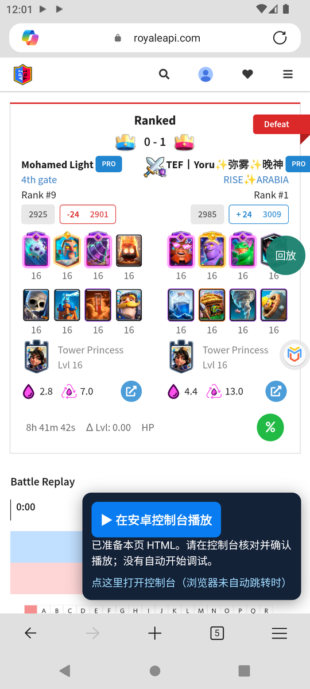
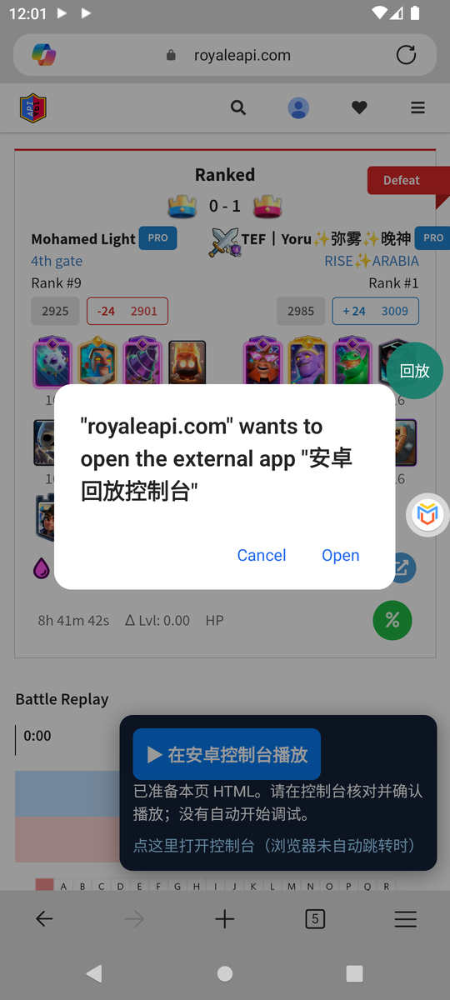
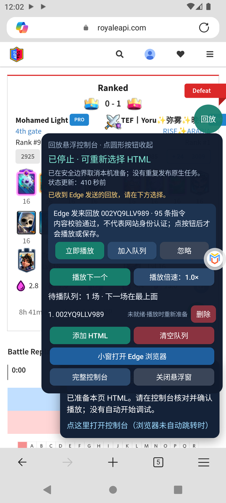

### 9.4 队列与提前准备

- 加入队列的回放会在游戏处于大厅时**自动提前准备**，每行右侧显示状态：等待准备 / 准备中·读取资源 / ✓ 已就绪 / 未就绪·播放时重新准备。
- 已就绪的回放点「播放下一个」后只需加载画面即可开播。
- 提前准备只做准备，**从不自动开播**。
- 若准备期间游戏被系统关闭（手机虚拟机内存紧张时常见），该行显示“未就绪·播放时重新准备”，点「播放下一个」会重新打开游戏并准备。

## 10. 卡住时：重置所有回放进程（防呆按钮）

hotfix37 新增。当状态一直停在“准备中 · 正在启动本机任务”、或提示“旧回放现场尚未释放”而不能播放时使用。常见原因是准备过程中虚拟机或模拟器被重启，留下了一份无人跟进的任务记录。

- 位置：完整控制台最下方「重置所有回放进程（卡住时用）」，以及悬浮面板里的「重置所有回放进程」。
- 防误触：需要在 **5 秒内连点两次**才会执行。
- 它会：结束所有回放执行进程，强制关闭游戏（同时清除游戏里残留的回放组件），把当前任务记录归档。
- 它不会：删除队列、已保存回放、历史记录或诊断文件。
- 重置后重新打开游戏，进入大厅，再点「播放下一个」。

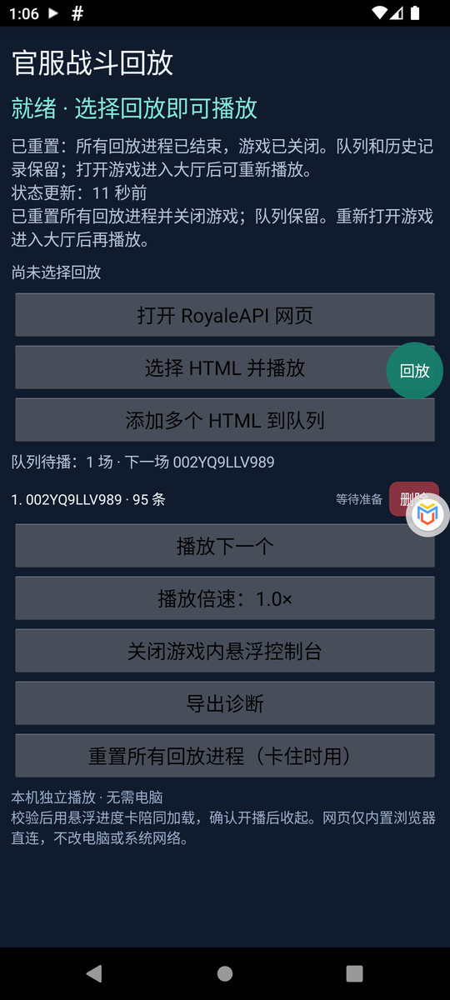

## 11. 升级

1. 下载新版 APK，核对 `SHA256SUMS.txt`。
2. 覆盖安装（虚拟大师里用「导入」）。不要卸载，不要清除数据。
3. 覆盖安装会结束正在运行的控制台与悬浮窗，重新打开控制台即可。若当时有“已就绪”的回放，会显示“未就绪·播放时重新准备”。
4. 升级 Edge 桥接脚本时，用新文件完整替换旧脚本内容。

## 12. 出错时：导出诊断

1. 在控制台底部点「导出诊断」，选择保存位置（如 Download），等待“已保存（N 份记录）”提示。
2. 把 ZIP 私下发给维护者，并附上控制台版本号和错误截图。
3. 诊断 ZIP 不含原始 HTML、游戏 APK 或浏览器 Cookie，但含本机路径、进程信息和解析后的回放记录，**不要公开分享**。
4. 不要反复点播放、不要清除数据。控制台不会自动重试原生操作，现场记录保留用于排查。

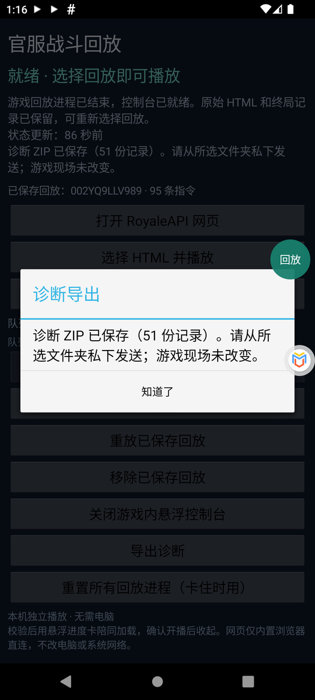

## 13. 常见的播放失败情形

| 现象（控制台或诊断里的提示） | 原因 | 处理 |
|---|---|---|
| 准备停在“等待游戏启动并进入空闲大厅”，约 4 分钟后取消 | 游戏没在运行，或停在加载界面、弹窗、对战中 | 先打开游戏、关掉弹窗、回到大厅，再点「播放下一个」 |
| 游戏开头显示“更新错误”，或启动后反复闪退 | 网络没通（MuMu / 虚拟机里的代理没开），或虚拟机卡顿 | 确认代理已连接后点「重试」；仍闪退先按「冻结卡顿的指纹服务」 |
| 整台虚拟机很卡、“Virtual Master isn't responding” | 虚拟大师的指纹服务占满一个 CPU 核心；或虚拟机存储将满 | 「冻结卡顿的指纹服务」；「清理旧运行环境和任务记录」 |
| “core process crashed in the VM”、虚拟机自动重启 | 外层内存不足 | 关闭其他应用、给虚拟机更多内存，或换 8 GB 以上内存的手机 |
| 一直“准备中 · 正在启动本机任务” | 上一次任务没有释放 | 第 10 节的「重置所有回放进程」 |
| “第 N 条技能的合法目标数为 0”，整场“已探索的技能分支均未通过整局校验” | 用默认随机种子模拟时，网页记录里放技能的那一刻，模拟中没有可放技能的英雄（英雄已死或未充能） | 卡组含猎人 / 骷髅之王时会换种子继续找，等它跑完；其他对局请导出诊断 |
| 终局“仅胜负相同”“与网页不符”或“终局近似”，但可以播放 | 随机性（猎人散射、墓园骷髅落点等）。英雄技能分配已由溢出圣水限定 | 可直接播放；想更接近可让种子搜索跑完。网页不含真实种子，结果为推断 |
| “截至网页结算时间，溢出圣水与网页不一致……未放行” | 所有完整组合的英雄技能分配（或出牌时圣水）都与真实对局不同；提示里列出双方网页值与模拟值 | 导出诊断发给维护者；这类结果不放行 |
| “原生牌序有界校准未通过” | 发牌排不出网页的出牌顺序。含圣水采集器 / 镜像的卡组，hotfix65 会自动换随机种子（提示“开局牌序：……换随机种子”） | 升级到 hotfix65；仍失败请导出诊断 |
| “终局无法完整比对” | 某座塔缺少网页数据或模拟记录，不代表不一致 | 照常播放；导出诊断以便补齐 |
| 同一场回放上次完全一致，这次却不一致 | hotfix54 之前按 HTML 文件生成种子，重新保存网页后种子列表变了 | 升级到 hotfix54；准备过一次后会记住最接近的种子 |
| “本机调试器无法执行原生函数调用”“stop for observation failed” | 虚拟机里调试器不稳定 | hotfix54 会自动重启游戏继续；仍失败用重置按钮后重试，或改用 MuMu |
| “自动恢复未通过归属检查”、游戏停在加载界面 | 失败时无法确认组件状态属于本次任务，为安全起见没有自动关闭游戏 | 重置按钮恢复，重新打开游戏后再播，并导出诊断 |
| “source card level missing or unsupported: …” | 保存的网页不完整（页面未加载完，标题只是 RoyaleAPI 首页） | 回放页完全加载后重新保存 / 发送 |
| “游戏库校验失败” | 游戏不是 38.4.2 审计版本，或被修改过 | 从腾讯官方渠道获取匹配版本，不要关闭校验 |
| “游戏回放进程已结束” | 准备期间游戏被系统回收内存 | 重新打开游戏后再播 |
| “Install failed insufficient storage” | 虚拟手机空间不足 | 删除 `Imports` 里的旧 APK 副本，或用「清理旧运行环境和任务记录」 |
| Edge 点了按钮没反应 | 浏览器桥接未拉起控制台 | 再点面板里的「点这里打开控制台」；或保存完整 HTML，用「选择 HTML 并播放」导入 |

失败后先点「导出诊断」：`error.txt` 写明失败原因，`page-comparison.json` 逐塔列出网页血量、模拟血量和判断依据，`seed-search.json` 记录试过的每个种子。

## 14. 本版修复了什么（hotfix12–37）

为了让回放在虚拟大师里跑通，并缩短准备时间：

- 兼容虚拟大师对内存映射文件的异常输出：截断行、重复段、空行、乱序的匿名映射。只跳过能证明无害的行，且不把它们当作可读内存；其他异常仍停止。
- 虚拟机里调试器找不到 `mmap` 时，向调试器登记经过核验（文件哈希、内存字节、地址三者一致）的系统 libc，使原生调用可以执行。
- 修正 `/data/user/0` 与 `/data/data` 符号链接导致的“取消后无法释放 / 无法退出”。
- 修正虚拟机里 `/system/bin/am` 无法直接执行导致的“重放本场 / 退出回放”失败。
- 游戏不在运行时，不再误报“游戏进程检查未通过”。
- 读取资源提速：减少重复解析 0.5 MB 进程映射表，缓存 30 MB 游戏库的哈希；虚拟大师里从约 2 分钟降到约 6 秒，安全检查不减少。
- 悬浮控制台始终显示「小窗打开 Edge 浏览器」按钮。
- 出错原因写入诊断文件，即使虚拟机丢掉了命令输出也能看到。
- 新增「重置所有回放进程」防呆按钮（两次确认）。
- 游戏没运行时点播放会先自动打开游戏；准备失败后不再自动反复重试。
- 长对局的读取上限与虚拟机加载场景的等待时间放宽。
- 随机种子搜索只用于含骷髅之王或猎人的卡组，可随时停止并用最接近的结果开播；技能目标始终要求完全一致。
- 皇家厨师等塔楼兵种：预演的塔血观察器按本局实际塔编号识别六座塔，修复此类对局一预演就失败（误报 excessive observation）；被摧毁的厨师塔也能正确比对。
- 终局比对统一为同一套逐塔规则，缺少记录时标为“无法完整比对”，不再误判为不符；网页左右公主塔顺序反了时按血量证据纠正（修复 02RYPY228YCQ 等对局被误判、无法播放）；诊断新增 `page-comparison.json`。

- hotfix38–54：同一场回放可稳定复现（种子按对局内容生成，并记住最接近的种子）；英雄技能先选六塔血差最小的组合再匹配种子，加入分支定界剪枝与“先筛选后精修”；调试器丢失游戏进程后自动重启游戏继续准备；游戏短暂不在大厅或任务队列拒绝时安全卸载并重试；新增「冻结卡顿的指纹服务」「清理旧运行环境和任务记录」按钮。详见 [更新说明-hotfix54](更新说明-hotfix54.md)。
- hotfix55–65：终局时间参与匹配；溢出圣水作为英雄技能的硬约束（按网页结算时间截止、不一致不放行）；圣水采集器 / 镜像不进开局手牌，发牌按引擎规则一次算出，必要时自动换种子。详见 [更新说明-hotfix65](更新说明-hotfix65.md)。

## 15. 安全与许可

- 本项目不修改、不重新签名游戏 APK，不提供 Root、破解或绕过手段，不收集账号或 Cookie。
- 控制台只读取已核验的游戏版本，所有原生调用前都会核对进程身份与代码指纹。
- 第三方组件许可见资料包中的《组件来源与许可》。游戏、MuMu、虚拟大师、Edge、篡改猴版权归各自所有者。
- 本工具仅用于观看你有权访问的对局回放，请遵守游戏与网站的服务条款。
