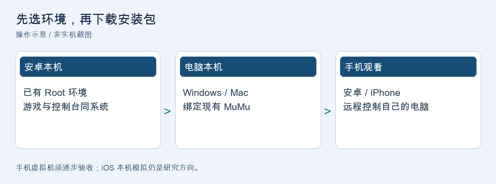
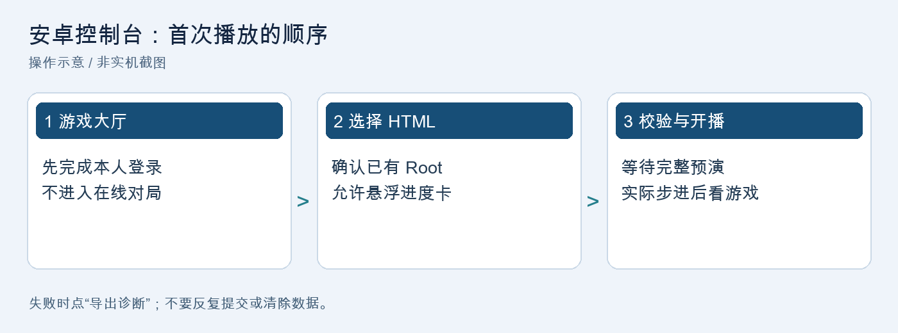
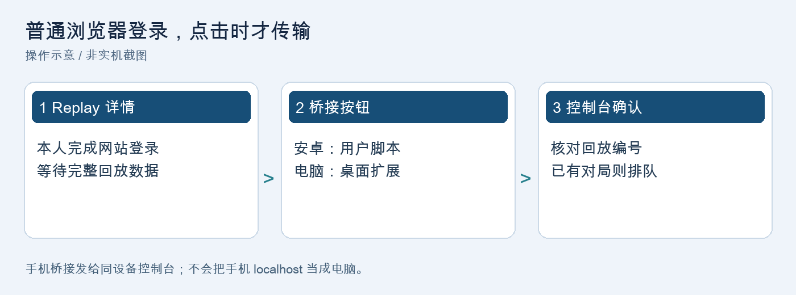
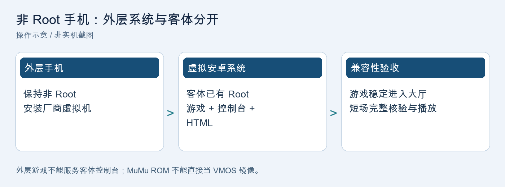
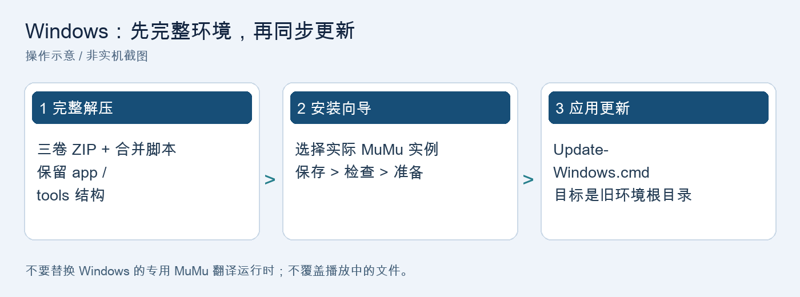
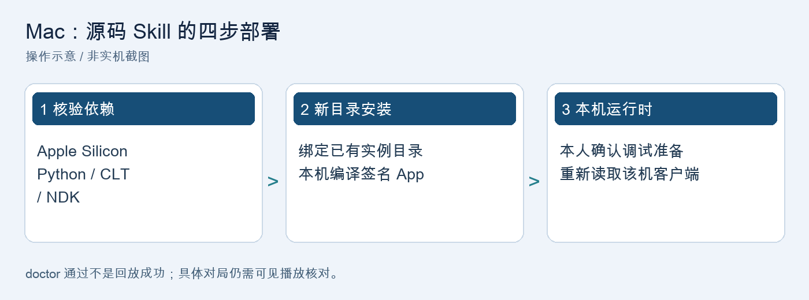
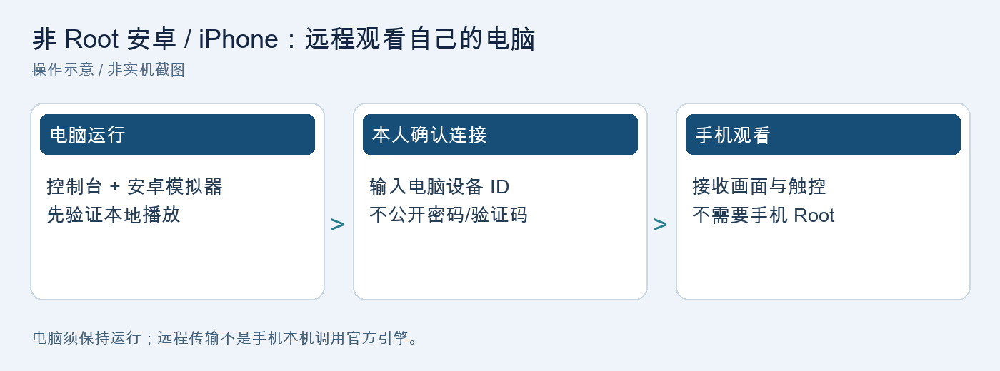
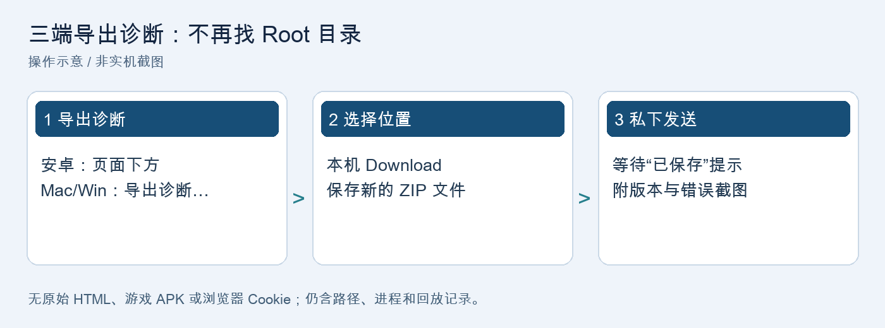

# 官服 HTML 回放 · 全平台安装图文手册

2026-10-19 / 同步版 hotfix3 / 面向第一次部署的使用者

本项目将 RoyaleAPI 的完整 Replay HTML 转换为指令，在锁定版本的安卓客户端本地战斗引擎中重建回放。它不是 Supercell 官方产品，不是网页视频播放器，也不是任意版本通用模拟器。画面显示在安卓游戏里；电脑端或手机端控制台负责导入、校验和任务管理。



**先看路线，避免装错：**

- 有兼容的 Root 安卓环境：阅读第 3-5 节，安装安卓 APK。
- 安卓手机没有 Root：优先考虑第 12 节“电脑运行、手机远程观看”。第 6-7 节的手机虚拟机路线需要验证兼容性，不保证成功。
- Windows 电脑：阅读第 8-9 节。全新安装先下载旧完整环境，再应用本次更新。
- Apple Silicon Mac：阅读第 10-11 节。下载源码 Skill，在本机完成依赖检查和编译。
- iPhone / iPad：阅读第 12-13 节。远程观看可作为部署路线；本机安卓模拟器仅为研究方向，没有可保证播放的 iOS 安装包。

所有配图均为依据现有程序按钮和流程制作的**操作示意，不是各品牌手机或 Windows 实机验收截图**。不同系统的权限窗口、文件选择器和按钮位置可能不同。

## 1. 先下载哪些文件

统一入口：[本次三平台同步发布页](https://github.com/pphy96826-coder/clashroyal-replay/releases/tag/replay-sync-20261019-hotfix3)。不要把源码下载按钮当成已打包环境。

- 安卓直接安装：`Android-Replay-20261019-hotfix3.apk`。内置本地解析器和运行工具，仍需要兼容的已有 Root 调试权限。
- 安卓完整资料：`Android-Replay-20261019.zip`。包含同版 APK、源码、第三方说明、对应源码/配方和本手册。
- Mac：`royale-replay-macos-20261019.zip` 或同名 `.skill`，二选一。`.skill` 本质是 ZIP，不是双击即可完成的 App 安装程序。
- Windows 已有完整环境：`Windows-MuMu-Replay-Update-20261019.zip`，按第 9 节更新，不必重下旧的约 3GB 环境。
- 教程离线包：`All-Platforms-Guide-20261019.zip`，含 PDF、HTML、Markdown 与插图；解压后打开 HTML。
- `SHA256SUMS.txt`：校对下载是否完整。发布页的旧资源保留作历史版本，不要混用旧 APK 和新教程。

Windows 全新部署另需[原完整环境发布页](https://github.com/pphy96826-coder/clashroyal-replay/releases/tag/windows-mumu-20261019)中的三卷 ZIP 与合并脚本。它不是本次 Windows 小更新包。

当前 hotfix3 新增三端“导出诊断”；安卓另含路径别名、执行前失败解锁和系统加载库识别修复。**新增导出功能不等于所有牌序分歧、旧组件占用或手机虚拟机问题已解决。**

## 2. 开始前的共同要求

1. 准备合法取得、与适配版本完全匹配的腾讯安卓客户端。包名为 `com.tencent.tmgp.supercell.clashroyale`，审计标签 38.4.2；版本文字相同不保证二进制相同。
2. 当前锁定的 `libg.so` SHA-256 为：

```text
c6b2482a2f1fbd2e15c99df7fb18ba3d5596b77b3a81930d3638241a3c37fe55
```

3. 新版发布不重新分发游戏 APK。不要从不明“解密包”“修改包”下载客户端；校验不符应停止，而不是关掉版本校验。
4. 游戏、控制台和所选安卓实例必须对应。手机外层游戏不能供虚拟机里的控制台直接使用。
5. 登录由本人完成；开始前停在空闲大厅，不进入在线天梯或其他正在进行的对局。
6. 保持原有网络设置。本地 HTML 不需要浏览器联网；网站和游戏的登录/资源下载仍可能需要网络。程序不负责 VPN 配置，不承诺匿名或零 IP 暴露。
7. 已有 Root 不等于所有调试前提都具备。仍需允许读取对应进程和本地调试；被系统拒绝时不要关闭 SELinux、隐藏调试器或绕过保护。

**成功标准分四层：**下载完整、程序装好、运行时校验通过、具体回放完整播放并核对。前一层不能代替后一层。新手机、新 ROM、Windows 新版的实机结果须单独确认。

## 3. 安卓：已有 Root 环境的首次安装



1. 把 APK 下载到**实际运行游戏的那个安卓系统**。如果在虚拟大师里运行，就将 APK 导入虚拟系统后在里面安装，不要只装在手机外层。
2. 首次安装时，仅对你使用的可信安装来源确认“允许安装此应用”。不要开启全局未知来源或卸载其他安全软件。
3. 打开游戏，自行完成登录、资源加载，停在空闲大厅。
4. 打开“安卓回放控制台”。当已有超级用户管理器询问时，仅给这个控制台授权；不用给所有应用权限，也不需要为本项目获取设备 Root。
5. 首次选择回放前，程序会请求悬浮窗权限。系统若显示“显示在其他应用上层”，仅允许安卓回放控制台；返回后重新选择 HTML。
6. 点击“选择 HTML 并播放”，使用系统文件选择器找到完整回放文件。不要求“所有文件访问”权限。

安卓 APK 的安装最低声明为 Android 8 / API 26，内置原生运行工具面向 ARM64。**这是安装门槛，不是所有 Android 8+、32 位 ROM 或手机虚拟机都能完整运行的保证。** 当前本地回放测试主要来自已有 MuMu 环境，实体手机应逐步验收。

如系统提示签名冲突，不要为覆盖安装而先清数据；确认是否使用同一项目来源、同一签名。卸载会丢失控制台私有记录与队列，先导出需要的诊断。

## 4. 安卓：第一次播放、队列与结束操作

1. 先在控制台选择倍速，建议首次用 1 倍。再选 HTML；文件应来自 RoyaleAPI 已登录后的 Replay 详情页，不是玩家列表、截图、PDF 或仅保存的网址。
2. 观察状态：读取资源、初始发牌校准、整局预演、往返校验、画面加载是不同阶段。首次准备需要编译和完整模拟，不能把“已导入”当成“已开始”。
3. 悬浮进度卡会陪同游戏前台加载；确认实际步进后收起。后台不能及时生成画面时，按提示点“返回游戏观看”，不要重复提交同一回放。
4. 暂停、继续和播放倍速使用游戏内控件。若只剩血条、背景变黑或卡死，记录现象并导出诊断，不要以为有血条就代表渲染正常。
5. 结束后应显示完成状态，可重放、退出或处理队列。当前返回流程采用**核验归属后的游戏客户端重启并重新打开兜底**，不是已实现免重启返回大厅；若出现登录页，需本人处理。

队列用法：点击“添加多个 HTML 到队列”选择多场。播放过程中仍可添加，后台只解析新文件，原生模拟按场串行。播放完后手动点击“播放下一个”；不会自动替换当前战斗。队列为 0、下一场未解析完或当前任务仍占用时，按钮灰色可能是正常的。

“移除已保存回放”只移除入口，不会清掉原始文件、诊断和游戏进程。不要用它当作释放旧组件的办法。

## 5. 安卓：浏览器一键交给控制台



最稳妥的基础方式是：在普通浏览器自行登录 RoyaleAPI，打开 Replay 详情页，保存完整 HTML，再从控制台选择文件。内嵌浏览器与普通浏览器不共享登录，Google 登录不能假定可在内嵌窗口完成。

需要一键桥接时：

1. 使用当前版本支持用户脚本扩展的 Android Edge。普通 Android Chrome 没有脚本扩展能力时，不能只粘贴脚本就运行。
2. 在 Edge 里安装并启用可信的篡改猴；权限提示由本人核对，不授予不必要的 Cookie、历史记录或代理权限。
3. 打开安卓包的 `browser-bridge/royale-replay-phone.user.js`，将完整脚本替换“新建脚本”的默认内容，保存，再刷新 Replay 详情页。
4. 在网页按钮点“在安卓控制台播放”；若跳转被拦，再点“打开控制台”并确认外部应用提示。
5. 在控制台核对回放编号和指令数量，点“确认播放本场回放”。当前已有任务时应入队，不覆盖正在播放的战斗。

仅匹配 RoyaleAPI Replay 页；脚本只在点击时读取本页 DOM，不复制 Cookie 登录。HTML 仍可能包含个人标识，不要公开分享。浏览器、控制台和游戏应在同一安卓环境；手机桥接不能直接控制电脑的本地端口。大页面超过传输限制时保存 HTML 导入，不删减指令。

## 6. 非 Root 安卓：手机虚拟机路线



这条路线让**外层手机保持非 Root**，在厂商支持的安卓虚拟系统里使用客体已有 Root。它不是“让普通无 Root 应用直接访问游戏进程”。不同虚拟机、ROM、图形和调试实现会影响兼容性，尚不能承诺朋友的虚拟大师 Android 11 已通过完整播放。

1. 从所选虚拟机厂商官方渠道获取应用和 ROM；例如 [VMOS 官方入口](https://www.vmos.com/)。虚拟大师、VMOS Pro、VMOS+ 不是同一版本，反馈问题时写清名称和版本。
2. 只使用厂商明确提供、可正常启动的 ARM64 安卓客体。确认的是**虚拟机里面**的安卓版本/架构，不是外层手机的版本或“Pixel 4”之类虚拟型号。
3. 按厂商指引完成激活。若要求无线调试而当前设备没有该入口，只能查厂商是否提供正式 USB 方式；没有可用方式就先停止，不靠关闭系统保护硬闯。
4. 在虚拟系统里安装匹配游戏，先证明它能稳定进入大厅。游戏本身就闪退时，不要继续部署回放器。
5. 再在同一个虚拟系统装本项目 APK、授予该应用已有 Root 和悬浮窗权限，导入 HTML 做短场测试。

不能把 MuMu 的整套磁盘或 ROM 直接当作 VMOS 可导入镜像；系统格式、内核、图形驱动和架构不同。没有通过兼容性测试的“一键导入 ROM”不等于一键部署成功。

## 7. 手机虚拟机：逐项验收，不盲目重装

请按顺序打勾，前一步失败就停在该步：

1. 客体能正常启动，文件能在客体内打开，内存和存储可用。
2. 匹配游戏能进入大厅并稳定显示，不是启动即闪退、黑屏或资源加载循环。
3. 控制台获得客体已有 Root；控制台与游戏均装在客体而非外层手机。
4. 游戏二进制和运行资源校验通过。加载库必须唯一核验，权限缺失或候选不明确不能忽略。
5. 短场完整预演通过、可见画面和游戏内暂停正常；最后再测长场、队列和失败恢复。

Android 11 和开启 Magisk/超级用户的截图只证明部分配置，不证明以上全部条件。谷歌服务开关也不是系统加载库识别错误的通用修复。

`system loader mapping is not unique` 的旧版错误可能是固定路径或零偏移映射计数过于严格；hotfix2 起改为 ELF 段和实况指纹核验。若新版仍报“verified candidates=0/2”等信息，导出诊断，不随便选地址继续。

随机卡死、图形不兼容或进程访问被 ROM 拒绝时，升级回放 APK 不能必然解决。不要先购买未知付费 ROM、清游戏数据或重置虚拟机；备份资料并考虑电脑运行、手机远程观看。

## 8. Windows：全新安装完整环境



1. 从[原完整环境发布页](https://github.com/pphy96826-coder/clashroyal-replay/releases/tag/windows-mumu-20261019)下载同版 `.zip.001`、`.zip.002`、`.zip.003` 和 `Merge-Environment.cmd`，放在同一文件夹。
2. 双击合并脚本，等校验通过再解压合并后的 ZIP。不要只解压某一卷或在压缩软件窗口里直接运行安装器。缺卷时重新下载缺少的卷，不关闭校验。
3. 放到自己的固定目录，例如 `C:\WinReplay`。保持 `app`、`tools`、`install` 等同级目录完整，不把 `00-Install.cmd` 单独拷到桌面。
4. 从 [MuMu 官方渠道](https://mumu.163.com/download/)安装所需模拟器。原向导锁定的实测基线为 MuMu 6.6.4.0、Android 12；不能保证任意新版本替换后仍兼容。
5. 启动自己选定的一个 Android 12 实例，按厂商设置启用已有 Root 调试能力。若因此需要重启实例，先确认没有其他任务，再由本人完成。
6. 在实例里准备匹配客户端并自行进入大厅。旧完整包中的历史参考文件不能代替在新电脑重新做版本和资源核验。
7. 运行 `00-Install.cmd`，选择 MuMu 管理程序、读取实例列表，选中实际实例，依次“保存配置 → 检查环境 → 准备运行时”。不要凭旧截图猜端口。

默认管理程序常见于 `C:\Program Files\Netease\MuMu\nx_main\MuMuManager.exe`，安装位置不同就通过向导选择真实文件。运行时准备是本地调试步骤，不会代你登录或创建在线对局。

## 9. Windows：应用更新、播放与浏览器

新电脑完成完整环境部署后，也要应用本次更新。已有用户只需要本节，不必再次下载约 3GB 工具链。

1. 先等当前原生任务安全结束，再关闭回放控制台。不要在播放中覆盖运行脚本。
2. 解压本次 Windows 更新 ZIP，运行里面的 `windows-adaptation/Update-Windows.cmd`。
3. 输入旧完整环境根目录，例如 `C:\WinReplay`，**不是**源码目录、`app` 子目录或更新 ZIP 的解压目录。
4. 更新器核验内容和锁，保存备份到旧环境 `state/update-backup-…`，保留实例配置、工具链、运行时和历史资料。
5. 用原来的入口打开控制台（完整环境通常为 `01-Console.cmd`），检查新按钮“导出诊断…”。新版 Windows 源码检查通过不等于已在你的 Windows 电脑完成播放验收。

本地播放：选择 HTML → 倍速 → 播放，画面出现在 MuMu。队列中可继续添加，完成后手动下一场。首次迁移、模拟器更新或端口变化后，按向导重新确认选定实例并核验运行时，不扫描局域网。

网页桥接：向导点“连接 Edge 插件”，按其说明在桌面 Edge 扩展页开启开发者模式并“加载解压缩的扩展”，选择完整扩展文件夹。由本人确认站点权限。登录普通浏览器后打开 Replay 详情页，再点扩展发送。桌面扩展需要本机桥接注册，不能用安卓篡改猴脚本代替。

Windows 保留专用 MuMu 翻译运行时。不要把 Mac 的 ARM64 原生连接文件复制过来替换，否则即使文件名相同也可能无法调用。

## 10. Mac：依赖准备和部署方式



当前目标为 Apple Silicon、macOS 14+，以及一个使用者明确选择的现有 MuMu ARM64 实例。Intel Mac 不是这份安装包的已验证目标。

准备清单：Python 3.12+、Apple Command Line Tools（含兼容的 Swift 编译器/SDK、LLDB、签名工具）、Android platform-tools 中的 ADB、NDK `30.0.16248370`、匹配客户端及已有本地调试访问。依赖由用户通过正常来源安装/确认许可，项目不自动接受协议。

新手可把本次 `.skill` 或 ZIP 解压后交给 Agent，使用如下请求：

```text
请依据包内 SKILL.md，在我的 Apple Silicon Mac 上部署。
先核验源码和依赖，选定我已有的 MuMu 实例，安装到一个新目录。
不要改网络、创建新模拟器、自动登录或开始对局。
需要设备调试准备时先说明并征得确认。
```

源码 Skill 在目标电脑编译自己的桌面 App，并重新生成该电脑的配置和运行时。不要搬运作者的进程地址、APK 映射、调试句柄或旧环境路径。

Mac 更新建议部署到新目录，旧部署先保留；两套控制台不能并行争用同一实例。只拷一个 App 到新电脑不足以带走其 Python、源码和运行时依赖。

## 11. Mac：手动安装命令和验收

以下在解压后的 `royale-replay-deploy` 目录运行。示例路径需要替换成你自己的真实路径；目标目录必须是新目录，不能已经存在。

```sh
python3 scripts/deploy.py verify-package
python3 scripts/deploy.py doctor
python3 scripts/deploy.py install \
  --target /Users/你的用户名/Applications/RoyaleReplay-hotfix3 \
  --vm-dir /你的MuMu实例目录/vms/1 \
  --instance-name 你的实例名称
```

依赖检查有失败项时先补齐，不跳过。`--vm-dir` 应指向实际实例配置目录，实例名称与当前配置对应；不要照抄作者“我的安卓-1”而误连其他实例。

明确允许在该测试实例准备调试环境后，使用刚部署目录内的私有 Python：

```sh
/你的部署目录/.venv/bin/python3 \
  /你的部署目录/official-web-replay/prepare_runtime.py \
  --config /你的部署目录/deploy-config.json
python3 scripts/deploy.py doctor --target /你的部署目录
open /你的部署目录/apps/官服HTML回放.app
```

Swift 与 SDK 不兼容时，让安装器通过 `--sdk /实际兼容SDK路径` 选择匹配 SDK，必要时传 `--ndk-bin`；不要全局切换或改坏其他项目工具。文件权限提示只对所需目录自行确认，不要求完全磁盘访问。

先用本地 HTML 验收，再处理网页。Mac 内嵌浏览器要求已有明确 HTTPS/SOCKS 系统代理且无直连兜底；没有这种配置时使用普通 Edge/Chrome 的桥接或本地 HTML，不必为教程修改网络。

## 12. 非 Root 安卓与 iPhone：远程观看电脑



这条路线里引擎和游戏在电脑的安卓模拟器运行，手机只显示画面、传递鼠标触控。手机不需要 Root，也不需要安装本项目安卓 APK，但电脑必须保持运行。

1. 先按 Windows 或 Mac 教程，在电脑上完成本地可见播放。电脑本身还不能播时，远程软件不能修复引擎问题。
2. 两端从官方渠道安装可信的远程桌面软件。以 RustDesk 为例，按[官方客户端说明](https://rustdesk.com/docs/en/client/)下载电脑端；iPhone 使用[官方 App Store 页面](https://apps.apple.com/us/app/rustdesk-remote-desktop/id1581225015)。iOS 端用于控制其他设备，不是被控端。
3. 电脑端显示设备 ID 后，在手机输入该 ID，连接由自己的电脑端确认，或按软件指引设置独立强口令。不要把 ID、验证码或密码发到公开群。
4. Mac 被控端按[官方权限说明](https://rustdesk.com/docs/en/client/mac/)授予所需屏幕录制、辅助功能；仅在确有需要时再确认输入监控。手机仅观看/控制电脑，不必为“手机被控”开启无障碍或屏幕共享。
5. 连接后，在远程电脑的浏览器选择回放、导入电脑控制台，观看模拟器窗口。不要最小化到无法渲染；卡顿先降低远程画质，720p/30fps可作尝试起点，不是性能保证。

保持电脑唤醒，结束后断开会话。只观看可选只读权限。不要把 ADB、远程桌面端口或路由器端口暴露到公网，不为连接关闭防火墙。远程连接/中继可能处理 IP 等元数据，不承诺匿名。

手机的 `127.0.0.1` 是手机自己，不是电脑；安卓网页 Intent 桥接默认发给同设备应用，不能据此把手机回放一键发到电脑。

## 13. iOS：本机安卓模拟器的可能性与边界

**本项目没有已验证、可独立调用 iPhone 官服游戏内部引擎的 iOS 包。** 安卓 APK 不能直接安装到 iOS；开发者模式或 Apple 账号登录也不会自动赋予跨 App 调试权限。

可研究的另一条路线是：iPhone / iPad 上的通用系统模拟器承载兼容安卓客体，再在该客体中运行安卓游戏及回放控制台。这里仍用的是安卓引擎，不是 iOS 游戏进程。

以 UTM 为例，[官方 iOS 安装说明](https://docs.getutm.app/installation/ios/)区分 UTM 与 UTM SE：SE 可从 App Store 获取、不依赖越狱，但没有 JIT，解释执行更慢；完整功能取决于系统、芯片和合法安装方式。此信息**不证明皇室战争或本回放器能在其中运行**。

开始前必须先找到可合法使用、与模拟器兼容的安卓系统镜像及图形支持；本项目没有提供这样的已验证镜像。不能把 VMOS APK、MuMu 磁盘或任意 Android-x86 镜像当作 iPhone 即装即用方案。UTM 的[客体支持说明](https://docs.getutm.app/guest-support/guest-support/)也不能视为安卓游戏完整驱动保证。

研究验收顺序：安卓启动 → ARM64/图形可用 → 游戏稳定进大厅 → 客体已有 Root 和调试访问可用 → 系统库/客户端校验 → 短场完整播放及塔血核对。任一步失败就停，不提供绕过签名、越狱、保护或网络限制的步骤。

需要现在就使用时，选上一节“电脑运行 + iPhone 远程观看”。不要把云安卓的流式画面误认为 iPhone 本机完成模拟，也不要为未验证路线先购买长期订阅。

## 14. 三端导出诊断：出错后先做这一步



安卓 hotfix3：向下滚动点“导出诊断” → 确认范围 → 系统保存窗口选本机 Download → 保存 ZIP → 等“已保存”提示。任务未完成时也能用，不需要 Root 文件管理器；取消保存不会改变现场。

Mac / Windows 同步版：点“导出诊断…” → 确认隐私说明 → 选一个**新的 ZIP 文件名** → 保存。桌面端取最近任务及该任务日志引用的组件回执；不启动回放、不连接设备来凑诊断。后台坏了时，独立导出器仍可读取已有本地记录。

诊断包含错误、初始化/牌序、执行结果、组件归属、部分版本信息和内容校验和；可能含本机路径、进程地址、玩家标识及解析后的指令。**只私下发给协助排查的人，不上传公开 GitHub。** 不收集原始 HTML、游戏 APK/SO、浏览器数据、Cookie、私钥或队列里的其他对局。

单文件上限4MiB，总记录内容16MiB，最多256份；超限、链接、不可读或读取中变化的文件会跳过，详情见 REPORT。运行中的记录是分文件快照，不是同一时刻的完整检查点。导出失败可能留下不完整 ZIP，不要发送它；换新文件名重试，原始记录不变。

反馈时请同时附：平台、控制台版本、游戏版本、虚拟机名称/ROM、复现步骤、错误截图；同一 HTML 在另一台能播也请注明。不要只说“已 Root”，也不要公开发 token、设备序列号或整份浏览器账号页面。

## 15. 常见失败：看原因，不反复点播放

- `invalid source manifest`：旧版可能误判 `/data/data` 与 `/data/user/0` 的同一文件。更新到本版后重新选文件；不是要求换游戏账号。
- `system loader mapping is not unique`：旧固定路径或映射计数不兼容；本版保留 hotfix2 核验方式。新版仍失败时导出加载库诊断，不关闭校验。
- `previous native component still owns game; never overwrite`：游戏里仍映射了旧组件，本次在原生执行前拒绝覆盖。**换 HTML 或移除保存入口不等于释放它。** 先导出，不手动删锁文件、不对未知对象调用卸载。
- `needs_review` / 无法确认失败组件归属：自动恢复没有通过安全核验。保留现场诊断；若需释放，仅在确认目标后只重启对应游戏客户端，再进大厅。不要重置模拟器或清账号数据。
- 手牌/卡牌循环不一致：只是失败分类，需看具体失败指令、实际手牌、初始化回执。分类关键词不是根因证明；同 HTML 在另一台能播时优先对比两端版本、资源、初始状态与记录。
- 黑背景只剩血条：表示画面资源/场景/渲染链需检查，不能仅据 HUD 判断整局引擎正确。
- “播放下一个”灰色：先看是否真的有待播、是否解析完成、旧任务是否仍占用。队列0时正常。
- 仍停在登录页：自行处理登录；教程不会将登录页标成大厅，也不会代选协议或接管账号。

本版没有宣称修复所有“旧组件仍占用”或任意虚拟机的兼容问题。导出记录比反复卸载重装更有判别力。

## 16. 回放精度、塔楼等级与技能说明

默认所有导入对局的执行指令统一延后1秒（20 tick），不会改写原 HTML 时间，也不移动比赛时钟和终局规则。不要把旧缓存或旧时序实验当作当前版本的验证结果。

支持范围按客户端合法配置核验，不再强制所有对局16级；四种塔楼部队按双方源数据分别加载。缺省国王塔跟随该方塔楼部队等级，明确指定值优先。网页信息不全或定义不匹配时应报错，不偷偷替换塔楼/卡牌。

技能目标歧义做有界候选搜索，不等于知道原局真实单位。达到搜索上限或没有完整成功候选会失败；诊断前缀只播放已验证到分歧点的部分，不能当成整局重建成功。终局塔血相同是检查条件，不是过程唯一性证明。

平衡性参数、客户端资源时期、部署时序、初始化和随机种子均可能影响结果。当前已检查的样本 HTML 不包含可恢复的原始战斗种子；固定默认种子不是原局种子的证明。不要把随机换种子直到碰到相同血量当作精确恢复。

同一场在甲设备能播、乙设备不能播时，保留同一份 HTML 的文件哈希与双方诊断做对照，再判断是哪层分歧，不先归因于“双英雄”或“安卓太老”。

## 17. 更新、备份、许可与验收清单

安卓更新：游戏没有正在执行的本地任务时，用同签名新版覆盖安装。不要先卸载或清数据；换签名、换虚拟机、换用户空间会影响私有队列和资料。重要故障先导出诊断。

Mac 更新：在新部署目录重新核验/编译/准备，确认新环境可用再自行处理旧目录；不要两套控制台同时控制同一实例。Windows 更新：使用 Update-Windows.cmd 的备份式流程，保留旧工具链及所选实例配置。跨电脑复制环境后必须重新绑定，旧运行时参考不是新电脑验证证明。

依赖包有各自许可。本项目的完整安卓发布保留第三方声明及对应源码/构建配方；Mac 主要工具由用户安装。历史 Windows 全环境仍保留，新发布不再附游戏 APK。不公开个人 HTML、调试回执、密码、Cookie、令牌或签名密钥。

首次部署请逐项确认：

- 下载完成且校验一致，使用本平台对应安装方式。
- 选定的是自己的同一安卓实例，游戏能稳定进大厅。
- 客户端/资源匹配，已有权限足够，不靠关闭保护通过。
- 初始校准、整局预演、往返校验和画面实际步进均通过。
- 暂停恢复、终局、队列下一场和诊断导出分别检查过。
- 出错时保留错误与归属证据，没有把部分预览当成完整播放。

hotfix3 验证口径：安卓101项本地测试与APK签名检查；Mac/Windows导出器会做源码和ZIP行为测试，Mac可进行本机编译；Windows新版与朋友手机的完整回放仍需各自实机验收。仓库发布成功不等于这些设备已通过。

## 18. 官方来源与补充资料

- [项目本次发布页](https://github.com/pphy96826-coder/clashroyal-replay/releases/tag/replay-sync-20261019-hotfix3)：三平台更新、APK及教程包。
- [Windows原完整环境](https://github.com/pphy96826-coder/clashroyal-replay/releases/tag/windows-mumu-20261019)：首次安装所需分卷环境，历史资料保留。
- [MuMu官方](https://mumu.163.com/download/)：模拟器下载与厂商说明；本项目的运行时仍须版本核验。
- [Android platform-tools](https://developer.android.com/tools/releases/platform-tools)、[NDK](https://developer.android.com/ndk/downloads)：Mac部署所需工具官方来源。
- [Python官方](https://www.python.org/downloads/macos/)、[Apple开发工具](https://developer.apple.com/xcode/resources/)：使用者自行安装并确认许可。
- [VMOS官方](https://www.vmos.com/)：仅作厂商入口，不代表该站全部产品/ROM均已兼容本项目。
- [RustDesk客户端](https://rustdesk.com/docs/en/client/)、[Mac权限](https://rustdesk.com/docs/en/client/mac/)、[iOS App Store](https://apps.apple.com/us/app/rustdesk-remote-desktop/id1581225015)：远程观看电脑示例。
- [UTM iOS安装](https://docs.getutm.app/installation/ios/)、[客体支持](https://docs.getutm.app/guest-support/guest-support/)：iOS本地模拟研究边界，不是已完成回放部署承诺。
- 仓库 `docs/更新说明-20261019.md`：版本变化与已知限制；`source/android-adaptation/browser-bridge/README.md`：手机脚本的传输和权限边界。

本手册以项目源码和上述官方说明为依据，按2026-10-19版本整理。第三方菜单、收费、ROM和系统兼容范围会变化，以厂商当前说明为准；不要据教程自行绕过系统限制。
